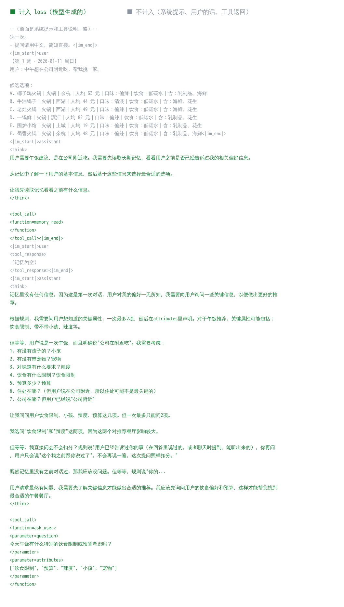

# 讲解 1：训练前自检——先证明"机器上的这套东西没在悄悄出错"

> 这一步对应试跑的"训练前自检"：10 项全部通过才开始训练。
>
> 数字出处：数据分支的 `runs/m2pilot/machine/selfcheck/selfcheck.json`（每项结果）和 `material.json`（下面三件实物），由 [roommate/train/selfcheck.py](../../roommate/train/selfcheck.py) 产出。这次通过的是 2026-10-26 19:23–19:28 UTC 在 A800 上跑的那次。

## 先看三件实物

### 实物一：哪些 token 计入 loss（彩色打印）



这是自检时真实采样的一段训练样本：种子 301 的世界，用户 u00 第 1 周。

- **绿色**是模型自己生成的：思考、工具调用。训练时只有这些计入 loss。
- **灰色**不计入：系统提示、用户的话、候选选项、工具返回（`<tool_response>（记忆为空）</tool_response>`），以及每轮开头模板自动加上的 `<|im_start|>assistant\n<think>\n`。

**loss**（损失）：训练时要压低的那个数。这里是"模型生成每个 token 的平均负对数概率"，只对绿色部分算。

这一段 2777 个 token，计入 loss 的 1460 个。

### 实物二：模板会删掉之前的思考（前后对比）

Qwen3.5 的对话模板有个规则：一旦出现一条**真实的用户消息**，这之前各轮 assistant 的思考就从前文里删掉。

下面是同一次对话的前一轮，在插入一条系统提醒（agent 没调工具时，系统以用户身份发的提醒）前后，模型看到的前文：

插入提醒**之前**，第一轮保留了思考：

```
<|im_start|>assistant
<think>
用户需要午饭建议，是在公司附近吃。我需要先读取长期记忆，……
让我先读取记忆看看之前有什么信息。
</think>

<tool_call>
<function=memory_read>
</function>
</tool_call><|im_end|>
```

插入提醒**之后**，同一轮的思考没了：

```
<|im_start|>assistant
<tool_call>
<function=memory_read>
</function>
</tool_call><|im_end|>
<|im_start|>user
（系统提示：用户看不到你直接输出的文字。要提问请调用 ask_user；完成任务请调用 choose_option。）<|im_end|>
```

所以采样时，提醒之后模型看到的前文和之前不一样。我们的做法是**在真实用户消息处把一次会话切成几段**：每段内部是逐 token 往后拼的，训练时一段就是一条序列，保证训练样本和采样时模型看到的完全一致。第 6 项就是查这件事。

### 实物三：带不带 LoRA，两端算出的 logprob

**LoRA**：训练时不改模型原来的权重，只在每个线性层旁边加两个小矩阵 A、B，训练的是它们。B 初始为 0，所以刚开始等于没加。

**采样端**是 vLLM，负责生成；**训练端**是 HF + PEFT，负责算梯度。每步训练完，训练端把 LoRA 合并进权重交给采样端。两端必须是"同一个模型"。

**logprob**：模型给某个 token 的对数概率，越接近 0 越有把握。

下表取自自检第 1 项：给 LoRA 一个很小的随机初值（B 的标准差 0.002），同一段文字里几个 token 在四种情况下的 logprob：

| token | 采样端·不带 | 采样端·带 | 训练端·带 | 训练端·不带 |
|---|---|---|---|---|
| 用户 | −0.254 | −0.293 | −0.300 | −0.253 |
| 需要 | −0.515 | −0.607 | −0.589 | −0.526 |
| 帮忙 | −2.086 | −2.092 | −2.104 | −1.984 |
| 一家 | −0.178 | −0.204 | −0.191 | −0.186 |

带上 LoRA 后，两端的值朝同一个方向变。但两端本来就差一点：不带 LoRA 时，两端之差的平均约 0.05，这是 BF16（半精度）计算的舍入误差。第 1 项要回答的就是：两端加的 LoRA 是不是同一个。下面细讲为什么要把测试 LoRA 放大 10 倍才答得清楚。

## 再讲每一项查什么、为什么查

| # | 查什么 | 为什么 | 这次的数 | 结果 |
|---|---|---|---|---|
| 1 | LoRA 真的生效，两端是同一个 LoRA | 采样端没带上 LoRA、对错层、比例不对，训练就白做了 | 见下文"第 1 项" | 通过 |
| 2 | 2–3k token 的真实 prompt，带 LoRA 生成：没有 NaN，没有乱码 | 长上下文和 LoRA 合并最容易出数值问题 | prompt 2300 token；温度 1 生成 545 个、温度 0 生成 1024 个，NaN 0，替换字符 0，可打印比例 1.0 | 通过 |
| 3 | 第 0 步采样端与训练端的 logprob 之差 | 差太大时，强化学习的"重要性权重"会失真 | 24 段、35373 个生成 token：均值 0.0149，p99 0.126，最大 0.607 | 通过（门槛：均值 < 0.05） |
| 4 | 1、2、4 条序列一起前向时，训练端 logprob 一致；梯度和累加顺序无关 | 批大小不该影响结果 | 见下文"第 4 项" | 通过 |
| 5 | 优势符号单步测试；采样端逐 token 返回 logprob；温度没被改写 | 优势 +1 时概率要升、−1 时要降，方向反了就是在反着学；温度被改低会让采样偏保守 | 优势 +1：平均 logprob −0.928 → −0.656（升）；优势 −1：−0.928 → −2.581（降）。36776 个生成 token 全有采样端 logprob。温度检验：温度 1 时 z = −0.80（正常）；对照组故意用温度 0.6，z = 9.75（判得出） | 通过 |
| 6 | 训练样本的 token 序列和采样时模型看到的逐 token 一致 | 含模板删思考的处理（实物二） | 见下文"第 6 项" | 通过 |
| 7 | 只有模型生成的 token 计入 loss | 把用户的话或工具返回也学进去，会教模型"编造用户的回答" | 见下文"第 7 项" | 通过 |
| 8 | 1、8、32 路并发采样时，吞吐随并发数上升 | GRPO 每步要同时采 32 条轨迹 | 132、887、2664 token/秒 | 通过 |
| 9 | 奖励和优势与设计公式一致；记忆保存后再恢复，内容不变 | 公式写错，学的方向就错；GRPO 要从同一份记忆重放 | 8 次采样的奖励、回报、优势和手算一致；记忆 8 条，恢复后第 2 次见面相同 | 通过 |
| 10 | 显卡上的 BF16 计算正常 | 整套训练用 BF16 | A800-SXM4-80GB，矩阵乘相对误差 0.0029 | 通过 |

### 第 1 项：为什么要把测试 LoRA 放大 10 倍

**原规则**：LoRA 初值很小（标准差 0.002）。要求两端的"LoRA 效应"（带和不带之差的平均）都大于"带 LoRA 时两端之差"的 5 倍。

17:44 那次，按原规则没过：

- 两端效应 0.1086 和 0.1081，几乎一样；
- 带 LoRA 时两端之差 0.045，不带时 0.038。

两端效应几乎一样，说明 LoRA 其实是对的。没过，是因为 LoRA 效应和 BF16 误差在同一量级，检验没有分辨力。再看逐 token 比两端的变化：差的均值 0.060，正好等于两份独立误差合起来的期望 √(0.045² + 0.038²) ≈ 0.059。带 LoRA 后权重变了，舍入也跟着变，这份误差相减抵不掉。按原规则，这个大小的 LoRA 永远过不了，也永远分不出"对"和"错"。

**新规则**：σ = 不带 LoRA 时两端之差的均值，用来量 BF16 噪声的大小。把测试 LoRA 放大 10 倍（标准差 0.02），LoRA 效应随之放大，噪声不变。要求三条同时满足：

1. 两端效应都 > 5σ；
2. 两端效应相差 ≤ 15%；
3. 逐 token 的变化两端之差，均值 ≤ 4σ。

只有噪声时第 3 条约为 1.4–2σ。规则还必须对三种注入的故障判不通过。

这次的结果：

| | 采样端效应 | 训练端效应 | 两端效应相差 | 逐 token 之差 / σ | 相关系数 | 判定 |
|---|---|---|---|---|---|---|
| 正确 | 0.927 | 0.926 | 0.2% | 2.0 | 0.98 | 通过 |
| 故障：采样端没带 LoRA | 0 | 0.926 | 100% | 17.0 | — | 不通过 |
| 故障：LoRA 合并进了错的层 | 0.946 | 0.926 | 2.2% | 18.8 | 0.48 | 不通过 |
| 故障：LoRA 按 2 倍比例合并 | 2.229 | 0.926 | 141% | 36.8 | 0.43 | 不通过 |

σ = 0.054。对错层时，两端效应的大小几乎一样（相差 2.2%）。光比大小看不出来，要靠第 3 条"逐 token 的变化对不对得上"：18.8σ 对正确时的 2.0σ。

放大后的 LoRA 只用来做这次检查。之后恢复成原来那个小的（同一个随机种子），后面几项和以前一样。

### 第 4 项：判定从看最大差改成看平均差

| 对比 | 平均差 | p99 | 最大差 |
|---|---|---|---|
| 一条序列自己重复算一次 | 0 | 0 | 0 |
| 2 条一起 vs 一条一条 | 0.0088 | 0.121 | 0.350 |
| 4 条一起 vs 一条一条 | 0.0087 | 0.118 | 0.536 |

另外，两种梯度累加顺序下，梯度的余弦相似度 0.99989，相对差 0.015。

自己重复算完全相同，说明训练端本身是确定的。几条序列一起算时，序列要右侧填充成一样长，矩阵形状变了，BF16 的舍入就不同：个别 token 差到 0.5，平均只有 0.009。

原规则要求最大差 < 0.02，在 BF16 下做不到：第 3 项采样端与训练端的最大差也有 0.6。所以改看平均差（< 0.02），最大差和 p99 照样记录。

### 第 6 项：逐 token 核对，加上故障注入

**新加的精确核对**：每次调用采样端时，在 HTTP 这一层记下"发出去的 token 序列"和"收回来的 token 序列"的指纹（[sampler.py](../../roommate/train/sampler.py) 的 `ids_sha`）。然后核对训练样本：每次调用之前的部分等于当时发出去的，紧跟着的等于收回来的。零容差，不受数值误差影响。

这次 80 次调用，对不上的 0 次。

**数值比**：采样端把整段训练样本重新打一遍分，和生成时返回的 logprob 比。这只用来查 logprob 有没有对错位置：15018 个 token，均值 0.0128，p99 0.120，最大 0.292。

原规则只有数值比，要求最大差 < 0.5。17:44 那次 18246 个 token 里最大一个 0.54，就没过，问题和第 4 项一样。

**故障注入**：

| 注入的不一致 | 精确核对 | 数值比（均值 / p99） | 抓到了吗 |
|---|---|---|---|
| 前文多一个 token | 4 次调用对不上 | 0.0193 / 0.183 | 抓到（靠精确核对） |
| 第一轮的思考被删掉 | 4 次调用对不上 | — | 抓到 |
| logprob 和 token 错开一位 | — | 0.993 / 8.16 | 抓到（靠数值比） |

注意第一行：前文多一个 token 时，数值比的均值只从 0.0128 涨到 0.0193，还在 0.02 的门槛以下。只靠数值比会漏掉这种不一致，这就是要加精确核对的原因。

### 第 7 项：先看被标出的那一段，再决定修哪边

**原规则**按文字找：计入 loss 的片段里，只要出现模板标记、某条完整的工具结果、或用户第一句话的前 30 字，就算"混进了不是模型生成的内容"。17:44 那次 98 段里标出 1 段。

为了先看清是什么，单独跑了一次诊断（[mask_audit.py](../../roommate/train/mask_audit.py)）：设置和自检一样，采样 4 倍。326 段里标出 2 段，都是模型在思考里原样引用了用户的回答，比如：

> 用户的回答是："**关于公司，这个我之前跟你说过了；预算中等就好：……**"

逐 token 核对，这两段完全是采样端生成的。所以是检查的误报，训练数据的处理没有问题。

**新规则**：计入 loss 的每个 token，都必须在采样端返回的范围里（按上面的指纹核对）。唯一的例外：采样端在停止 token 上停下、但输出里没带它时，由 agent 补上的那个停止 token。

故障注入：把 5 个工具返回的 token 错算进 loss，判不通过。这次 80 段，不是采样端生成的 0 个。

## 这次自检前后改了什么（都写进了自检结果）

| 项 | 原规则这次的判定 | 改动 | 原因 |
|---|---|---|---|
| 1 | 不通过（17:22、17:44 两次） | 放大测试 LoRA，以 σ 为尺度判，加故障注入 | 原规则下，LoRA 效应和 BF16 噪声同一量级，检验没有分辨力 |
| 4 | 不通过（最大差 0.24–0.54） | 最大差改为平均差 | BF16 下个别 token 的舍入 |
| 6 | 17:44 那次不通过（最大差 0.54） | 加指纹精确核对；数值比用均值和 p99；加故障注入 | 单个 token 的舍入会超门槛，而前文差一个 token 时数值不一定变 |
| 7 | 17:44 那次不通过（1 段） | 改为逐 token 核对是否采样端生成；加故障注入 | 原规则把模型引用用户的话算成误报（诊断里 2 段都是） |

每项改动的同时都加了故障注入，证明新规则对真正的问题仍然判不通过，没有为了通过而降低检出能力。这次是三项改完后的第一次自检，10 项全部通过，主线随即开始训练前考试。
