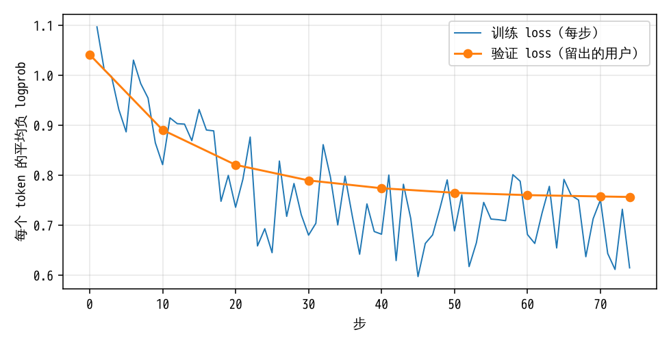

# 讲解 3：SFT——照着老师的示范学一遍

> 这一步对应试跑的 SFT。
>
> 数字出处：数据分支的 `runs/m2pilot/machine/sft/`（`train_log.jsonl` 训练日志、`data_stats.json` 数据统计、`done.json`）和 `runs/m2pilot/machine/eval/{pre,sft}/`（SFT 前后两次考试）。代码在 [roommate/train/sft.py](../../roommate/train/sft.py)。

## 先看同一个用户、同一次见面：SFT 前后

考场是种子 1 的世界，用户 u00，第 13 周（第 8 次见面）。用户说：

> 周末想跟老同学在我家那边聚一下，帮我选家店。

候选 6 家，正确答案是 C。

### SFT 前（未训练的 Qwen3.5-4B）

它没先读记忆，一上来就问"这次聚会大概几个人？预算大概多少？"，用户回答"这个我之前跟你说过了"。

这时它才去读记忆，记忆是空的：前几次见面，它从来没把用户说的东西记下来。

接下来它一项接一项地问：小孩、住处、公司、出行、晚归、过敏、饮食限制、辣度、菜系、宠物，又问一遍小孩、预算。13 次提问里 12 次得到"这个我之前跟你说过了"，只有晚归是新问到的（"晚上得早点回家，晚饭只能订 18:30 以前的。"）。用满 14 轮也没选。

判分：选对得 1 分，没选得 0 分，每问一次扣 0.15 分。这次 0 − 13 × 0.15 = **−1.95 分**。

### SFT 后

1. 第一件事读记忆。记忆里有它前几周自己写下的（工具返回原文，括号里的周数是工具标的）：

   > - 用户基本信息: 住在西湖；对乳制品过敏（必须避开）；预算：晚饭人均 90–150 元，午饭 32–50 元；最爱川菜。（第 1 周写入）
   > - 公司位置: 在拱墅上班（第 6 周写入）
   > - 辣度偏好: 无辣不欢，必须有辣（第 9 周写入）（第 9 周写入）
   > - 健康与饮食偏好: 上周体检：血糖偏高、胃不好，医生要求少吃甜的、辣的别吃了（清淡、低糖）。乳制品过敏（必须避开）。（第 10 周写入）

2. 问了 1 次"你住西湖，这次聚会想选在西湖附近吗？还是说家里搬过家了？"。用户其实已经说过搬到了余杭，记忆里没记下这次搬家，所以用户答"这个我之前跟你说过了"。
3. 选 C（蓉城记，川菜，余杭），正确。1 − 1 × 0.15 = **0.85 分**。

三点值得注意：

- **选对了，但理由里有错。** 它的思考写的是"用户住西湖……西湖只有 F，F 含乳制品，不行……最好是 C"。它一直以为用户住西湖。C 恰好在余杭，所以对了。记忆没跟上偏好的变化，SFT 没有修好这一点。
- **思考变成了英文**（"Let me start by reading memory to understand the user's preferences."）。这是从老师那里学来的习惯，讲解 2 里提到过：DeepSeek V4 Pro 的思考大多是英文。
- **思考很长**：后两轮思考都写满了 4096 token 的上限，被截断（分别约 1.1 万和 1.3 万个字符）。截断后考场替它补上思考结束标记，它接着给出了动作；这两轮都记为"思考超限"，算进格式错误。

## 再讲道理

**SFT（监督微调）**：让模型在示范对话上做"下一个 token 预测"，逐字学老师的输出。只学老师自己生成的部分（思考、工具调用）；用户的话、工具返回都不计入 loss（讲解 1 的实物一）。

**为什么先做 SFT**：未训练的模型在考场里常常兜圈子、用满轮次也不选（上面的例子）。强化学习要靠一组采样里有对有错才能学：一组全错，优势全是 0，什么也学不到。SFT 先把它拉到"大体会做"的起点，GRPO 才有信号。

### 用了哪些数据

- 老师（DeepSeek V4 Pro）在 4 个新世界（种子 101–104）里的 768 次会话，按讲解 2 的 6 条规则筛过，留下 **600** 次。
- 按用户留出 5%（4 个用户）做验证：训练 584 条序列，验证 16 条。验证集的用户训练时没见过。
- 留下的数据里，捷径①（没提过的偏好不问就选）和捷径②（提过的偏好又问）都是 0：
  - 要用到没提过的偏好的 128 次会话，老师全都问了；
  - 提过、至今没变的 1875 个偏好，一个都没再问。
- 考场用的是种子 1–3（全程）和 201、202（短程），和训练数据的世界不重叠。

### 怎么训的

| 设置 | 值 |
|---|---|
| 训练什么 | LoRA：秩 r = 16，α = 32，加在语言模型各层的全部线性层上；原权重不动 |
| 一步用多少数据 | 16 条序列，每条单独前向，梯度累加；loss 按 token 平均 |
| 学习率 | 1e-4，前 10 步线性升，之后余弦降到 10% |
| 轮数 | 2 轮，共 74 步 |
| 精度 | BF16 |
| 用时 | 19.4 分钟（A800 80GB） |

### loss 曲线

**这张图说明**：验证 loss 从 1.04 降到 0.76，前 30 步降得快，后面变平，没有回升，没有过拟合。训练 loss 每步只算 16 条序列，所以上下跳；最后一步 0.61。

## SFT 前后的考试

两次考试设置完全相同：温度 0，思考上限 4096 token，回答上限 8192 token。这和体检的设置一致。

95% 区间按用户重抽样得到（同一个用户的各次见面一起抽）。

| 指标 | 全程（种子 1–3，504 次） SFT 前 | 全程 SFT 后 | 短程（种子 201/202，336 次） SFT 前 | 短程 SFT 后 |
|---|---|---|---|---|
| 平均分 | −0.216（−0.307 ~ −0.121） | **0.718**（0.640 ~ 0.783） | 0.223（0.160 ~ 0.285） | **0.688**（0.644 ~ 0.729） |
| 选对的比例 | 46.2% | 86.3% | 70.5% | 89.0% |
| 平均提问次数 | 4.52 | 0.97 | 3.22 | 1.35 |
| 没做选择的比例 | 19.4% | 2.6% | 11.0% | 0.9% |
| 每轮思考 token | 1262 | 988 | 836 | 604 |
| 思考超过上限的轮次 | 27.5% | 16.1% | 14.5% | 6.2% |
| 捷径①：没提过的偏好不问就选 | 25.7% | 27.7% | 28.7% | 17.4% |
| 捷径②：提过的偏好又问 | 43.4% | 6.1% | 40.4% | 10.3% |

格式错误几乎全是思考超限：思考超限之外的格式错误，全程两次考试都是 0 轮，短程只有 SFT 前 1 轮。所以格式错误率和上表"思考超过上限的轮次"相同，不另列。

复算：`python -m roommate.train.report_numbers`（写进 `runs/m2pilot/report/numbers.json` 的 `joint_full` 和 `short`）。

对照：同一套全程考试，DeepSeek V4 Pro 是 0.833，Claude Opus 是 0.911（联合基线表见报告）。

从表里能看出：

- **分数大涨，主要来自"会读记忆、会写记忆、少问"。** 提问从 4.5 次降到 1 次；捷径②从 43% 降到 6%。
- **捷径①在全程考试里没降**（25.7% → 27.7%，区间重叠）。SFT 数据里捷径①是 0，模型也没学到"没提过的偏好要先问"。这正是下一步 GRPO 要盯的：GRPO 的停止规则就是"分数上涨主要来自捷径①上升"。
- **思考超过上限的轮次还有 16%**，大多是超长的英文思考。
