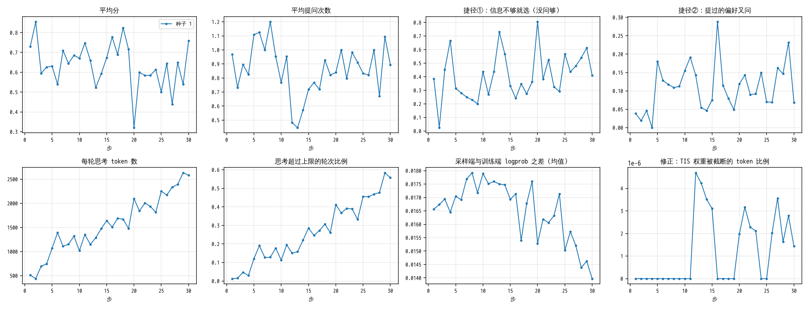

# 讲解 4：GRPO——同一道题做 8 遍，好的加强、差的减弱

> 这一步对应试跑的 GRPO。只跑了种子 1：种子 1 训完后的全程考试不高于 SFT 后，按事先定的规则，种子 2 没有跑（报告 6.3 节）。
>
> 数字出处：数据分支的 `runs/m2pilot/machine/grpo_s1/`：
> - `steps.jsonl`：每步一行；
> - `groups.jsonl`：每组的账本；
> - `events.jsonl`：检查点和续跑；
> - `drill.json`：中断演练；
> - `config.json`。
>
> 代码在 [roommate/train/grpo.py](../../roommate/train/grpo.py) 和 [trainer.py](../../roommate/train/trainer.py)，曲线由 `python -m roommate.train.figures` 画出。

## 先看一组账本

种子 1 的第 13 步，训练世界 302 里的一位用户（u16，从第 11 周开始的两次见面）。这位用户对乳制品过敏，爱吃面食，不吃辣。

- **第 1 次见面（第 11 周）**："周末想跟老同学聚一下，帮我选家店。"用户这次其实想换个区、在余杭聚，但请求里没说，问了才知道。这是两次见面的第 1 次，模型对这位用户一无所知，记忆是空的。
  - 正确答案是 F：葱油面铺，面食，余杭，清淡，不含乳制品。
  - B 也在余杭，但它是粤菜，而且含乳制品。
- **第 2 次见面（第 12 周）**：用户说刚搬到滨江，"周末想跟老同学在我家那边聚一下"。
  - 正确答案是 F：面面俱到，面食，滨江，不含乳制品。
  - C 也在滨江，但它是粤菜，而且含乳制品。
  - 过敏、菜系这些，第 1 次见面问过就该记下，第 2 次不用再问。这条轨迹属于"第 2 次见面要用到第 1 次的信息"。

模型（从 SFT 出发、已训了 12 步）把这两次见面完整做了 8 遍。每一遍叫一个"样本"，温度 1，所以每遍做得不一样：

| 样本 | 第 1 次见面：选了 / 问了几次 / 得分 / 回报 / 优势 | 第 2 次见面：选了 / 问了几次 / 得分 / 回报 / 优势 | 这次更新 |
|---|---|---|---|
| 1 | B / 0 / +0.00 / +0.85 / **+0.19** | F / 1 / +0.85 / +0.85 / **+0.70** | 加强 |
| 2 | F / 1 / +0.85 / +1.85 / **+2.03** | F / 0 / +1.00 / +1.00 / **+1.03** | 加强 |
| 3 | B / 0 / +0.00 / +0.00 / **−1.36** | C / 0 / +0.00 / +0.00 / **−1.17** | 减弱 |
| 4 | B / 0 / +0.00 / +0.85 / **+0.19** | F / 1 / +0.85 / +0.85 / **+0.70** | 加强 |
| 5 | F / 1 / +0.85 / +0.70 / **−0.08** | C / 1 / −0.15 / −0.15 / **−1.50** | 减弱 |
| 6 | B / 0 / +0.00 / +0.85 / **+0.19** | F / 1 / +0.85 / +0.85 / **+0.70** | 加强 |
| 7 | B / 0 / +0.00 / +0.00 / **−1.36** | C / 0 / +0.00 / +0.00 / **−1.17** | 减弱 |
| 8 | B / 0 / +0.00 / +0.85 / **+0.19** | F / 1 / +0.85 / +0.85 / **+0.70** | 加强 |
| 组内平均回报 | +0.744 | +0.531 | |

怎么读：

- **样本 2 最好**：第 1 次问了一次就选对，第 2 次不用问也选对，共 1.85 分。两次见面的优势都最大（+2.03、+1.03），这条做法被加强得最多。
- **样本 3、7 最差**：两次都不问，都选了含乳制品的粤菜，0 分。两次的优势都是负的，被减弱。
- **样本 1、4、6、8**：第 1 次不问就选了 B，错了（这就是捷径①：要用到没提过的偏好，没问就选）。第 2 次问了一次，选对。
- **一个要注意的地方**：样本 1 的第 1 次见面选错了，优势却是 **+0.19**，被轻微加强了。
  - 原因是第 1 次见面的"回报"把第 2 次的得分也算进去了：0 + 0.85 = 0.85，比组内平均 0.744 高。
  - 这是这套算法有意的设计：让第 1 次记没记下信息，能从第 2 次的得分里得到反馈。
  - 副作用是第 2 次做得好时，第 1 次的错选也会沾光。这一点写进了报告的"后续改进"。

复算：`figures.group_ledger_md()`，读 `groups.jsonl` 里第 13 步的第 4 组。

## 再讲道理

**GRPO**：一种强化学习方法，全称是"组相对策略优化"。

- 同一道题让模型做几遍，组成一"组"。
- 每遍和组内平均比：比平均好的，加强它的每个 token；比平均差的，减弱。
- 不需要另外训练一个"打分模型"，组内平均就是基准。

**这次的设置**：

| 项目 | 值 |
|---|---|
| 一道题 | 一条短程轨迹：同一个用户连续两次见面（训练世界 301、302，共 336 条，其中 71.7% 的第 2 次见面要用到第 1 次的信息） |
| 一步 | 4 道题 × 每道 8 遍 = 32 条轨迹、64 次会话 |
| 步数 | 30 步，每 5 步存一次检查点 |
| 采样 | 温度 1，思考上限 4096 token，回答上限 2048 token |
| 学习率 | 5e-5，训练的是 SFT 的 LoRA（从 SFT 的结果接着训） |
| 修正 | 截断重要性采样，上限 2：采样端和训练端算出的概率略有不同，按两者之比给每个 token 加权，比值超过 2 的按 2 算 |

**术语**：

- **得分**：判分。选对 1 分，选错或没选 0 分，每问一次扣 0.15 分。
- **回报**：从这次见面往后的得分之和。
  - 第 1 次见面的回报 = 第 1 次得分 + 第 2 次得分；
  - 第 2 次见面的回报 = 第 2 次得分。
- **优势**：（这一遍的回报 − 组内平均回报）÷ 组内标准差。
  - 正的加强，负的减弱，绝对值越大力度越大。
  - 8 遍回报完全相同时，优势全是 0，这组什么也学不到。种子 1 的 120 组里有 14 组是这样。

## 曲线（种子 1）

每个点是一步的 64 次会话，而每步换 4 个不同的用户，所以点和点之间跳得厉害。下面比较"最初 5 步"和"最后 5 步"的平均。

1. **平均分**：从 0.69 到 0.61。**这张图说明**：30 步里训练题上的分数没有上升。
2. **平均提问次数**：从 0.91 到 0.90，几乎没变。**这张图说明**：模型没有学着多问，也没有学着少问。
3. **捷径①（没提过的偏好不问就选）**：从 0.37 到 0.50，中间最高到过 0.81（第 20 步，那一步分数也是最低的 0.32）。**这张图说明**：捷径①有升高的迹象，但分数没跟着涨，所以不是"靠捷径刷分"。
4. **捷径②（提过的偏好又问）**：从 0.06 到 0.14。**这张图说明**：重复问也略有增加，和记忆没用好一致。
5. **每轮思考 token 数**：从 693 到 2424，一路上升。**这张图说明**：这次训练里变化最大、最确定的是思考越来越长。
6. **思考超过上限的轮次比例**：从 4.5% 到 51%。**这张图说明**：最后一半的轮次都写满了 4096 的上限、被截断。每步用时也从约 3.6 分钟涨到约 17 分钟。
7. **采样端与训练端 logprob 之差（均值）**：一直在 0.014–0.018 之间，和自检第 3 项（0.015）同一水平。**这张图说明**：训练端和采样端看到的是同一个模型，没有越训越偏。
8. **修正：TIS 权重被截断的 token 比例**：最高 0.0005%（每步最多 1 个 token）。**这张图说明**：两端的差太小，修正几乎没起作用，也不需要它起作用。

## 停止规则

卡里的规则："分数上涨主要来自捷径①上升，就停下这次训练"。

代码里（`shortcut_stop`）的判法：最后 5 步和最初 5 步比，三条同时满足才停：

- 分数涨了 0.05 以上；
- 捷径①涨了 0.10 以上；
- 少问省下的分占涨幅的一半以上。

种子 1 跑完时：

| | 变化 | 条件 | 满足吗 |
|---|---|---|---|
| 分数 | **−0.081** | > +0.05 | 否 |
| 捷径① | +0.127 | > +0.10 | 是 |
| 少问省下的分 | +0.002 | ≥ 涨幅的一半 | 否 |

分数没涨，规则没触发，按规定接着跑。捷径①的上升作为风险记进报告。

## 中断后接着跑的演练

1. 22:17:48，存下第 5 步的检查点。
2. 第 6 步跑完。
3. 22:28:01，第 7 步训练到一半时，强行杀掉训练进程（SIGKILL，进程来不及做任何收尾）。
4. 22:28:16，用 `--resume` 重新启动。22:28:27 从第 5 步的检查点接着跑，重做第 6 步和第 7 步。
5. 之后一直跑到第 30 步，没有再出错。

| 核对 | 结果 |
|---|---|
| 从哪一步接上 | 第 5 步（最近的检查点）；第 6 步杀掉前已经跑完，但还没存检查点，所以重做 |
| 题目顺序接得上吗 | 接得上：重做的第 6 步和原来的第 6 步是同样 4 个用户 |
| 结果一样吗 | 不一样：温度 1 采样，重做时分数 0.540，原来是 0.683。曲线只画重做的那次，因为它才进了最终权重 |
| 损失了多少 | 约 10 分钟：第 6 步加半个第 7 步 |

这说明机器中途断掉时，最多丢不到 5 步的进度，接上后训练能照常往下走。

## 这一步的进度

种子 1 用了 4.6 小时（含演练），30 步里训练题上的分数没有上升，思考长度涨了 3.5 倍。训练后的考试（全程、短程）是判断有没有学到东西的依据，见讲解 5。

种子 2：按规则没有跑。种子 1 训完后的全程考试 0.600，SFT 后 0.718，按用户配对的差 −0.118（−0.206 ~ −0.030），不高于 SFT 后。这条规则在看到种子 1 考试结果之前就定下并提交了，见报告 6.3 节。
